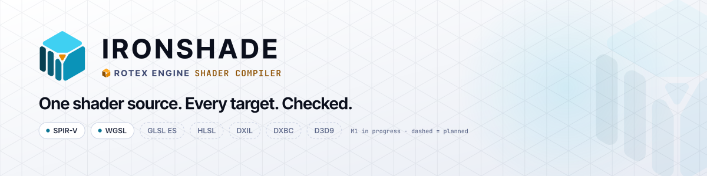

<!-- Banners are in-repo under docs/brand until rotex-assets has a tag.
     They can later be pinned to
     https://raw.githubusercontent.com/rotex-labs/rotex-assets/<tag>/brand/ironshade/github/ironshade-readme-banner-{dark,light}.svg -->
<p align="center">
  <picture>
    <source media="(prefers-color-scheme: dark)" srcset="docs/brand/ironshade-readme-banner-dark.svg">
    <source media="(prefers-color-scheme: light)" srcset="docs/brand/ironshade-readme-banner-light.svg">
    
  </picture>
</p>

# ironshade

A pure-Rust shader compiler for Rotex Engine. It aims to compile the Slang™ shading
language to SPIR-V, WGSL, GLSL ES, HLSL and legacy Direct3D bytecode through a
pluggable backend HAL.

> [!WARNING]
> **Early development, pre-1.0.** M0 establishes the compiler contracts and the shader
> oracle harness. Shader emission starts in M1 (SPIR-V and WGSL). APIs, crate
> boundaries and the artifact format can change in any 0.x release.

## Overview

Ironshade is designed for shader authors and engine developers who need multiple
graphics targets and a consistent view of shader bindings and layouts. Shader
source and typed shader graphs will lower into the same intermediate
representation, Ironshade Graph IR. A versioned backend HAL lets developers add
targets in their own Rust crates.

Each backend declares the capabilities of its target profile. Legalization
lowers operations through shared recipes and target-specific passes, then checks
the result before emission. Requirements that cannot be met produce diagnostics.
Emulation requires explicit compile policy approval. Artifacts retain entry
points, bindings, layouts, and remaps for the host application.

Ironshade is developed in the Rotex ecosystem and builds as a standalone Cargo
workspace.

## Crates

| Package | Description | Version |
|---------|-------------|---------|
| [`ironshade`](crates/ironshade) | Umbrella library and `ironshadec` CLI | 0.1.0 |
| [`ironshade-ir`](crates/ironshade-ir) | Shared representation for text and graph input | 0.1.0 |
| [`ironshade-caps`](crates/ironshade-caps) | Capability vocabulary and legalization planning | 0.1.0 |
| [`ironshade-target`](crates/ironshade-target) | Public backend HAL | 0.1.0 |
| [`ironshade-artifact`](crates/ironshade-artifact) | Versioned reflection and artifact format | 0.1.0 |
| [`ironshade-runtime`](crates/ironshade-runtime) | Planned live compilation service | 0.1.0 |

## Targets

| Output | Environment | Planned milestone |
| --- | --- | --- |
| SPIR-V | Vulkan | M1 |
| WGSL | WebGPU | M1 |
| GLSL ES 3.00 | WebGL2 | M3 |
| HLSL source | Direct3D | M3 |
| DXIL via DXC | Direct3D 12 | M4 |
| DXBC | Direct3D 10 and 11 | M5 |
| Shader Model 2 and 3 tokens | Direct3D 9 | M6 |
| Native DXIL | Direct3D 12 | M7 |

See the [architecture plan](docs/IRONSHADE_ARCHITECTURE.md) for milestone exit
criteria and the [language roadmap](docs/language-subset.md) for subset status.

## Getting started

Install [Rust with rustup](https://rustup.rs/) and run from the repository root.

```sh
cargo build --locked --workspace
cargo run --locked -p ironshade --bin ironshadec -- --help
cargo xtask check-layering
```

See [CONTRIBUTING.md](CONTRIBUTING.md) for the local checks and
[AGENTS.md](AGENTS.md) for dependency rules.

## License

Licensed under either of

* Apache License, Version 2.0 ([LICENSE-APACHE](LICENSE-APACHE))
* MIT license ([LICENSE-MIT](LICENSE-MIT))

at your option. See [NOTICE](NOTICE) for third-party attributions.

<sub>Part of <a href="https://github.com/rotex-labs">Rotex Engine</a> · Brand assets: <a href="https://github.com/rotex-labs/rotex-assets">rotex-assets</a> · Slang™ and the Slang logo are trademarks of the Khronos Group Inc. Ironshade is not affiliated with or endorsed by the Khronos Group.</sub>
