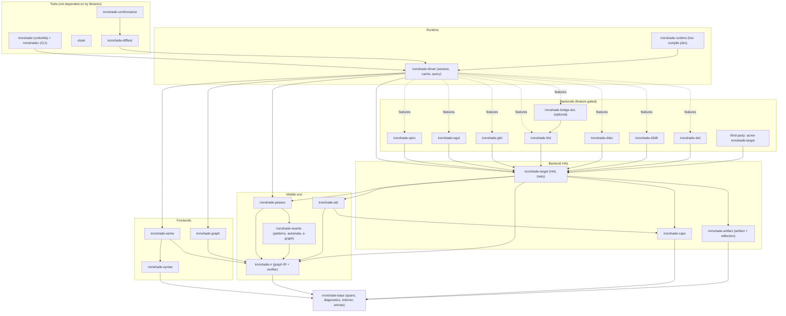
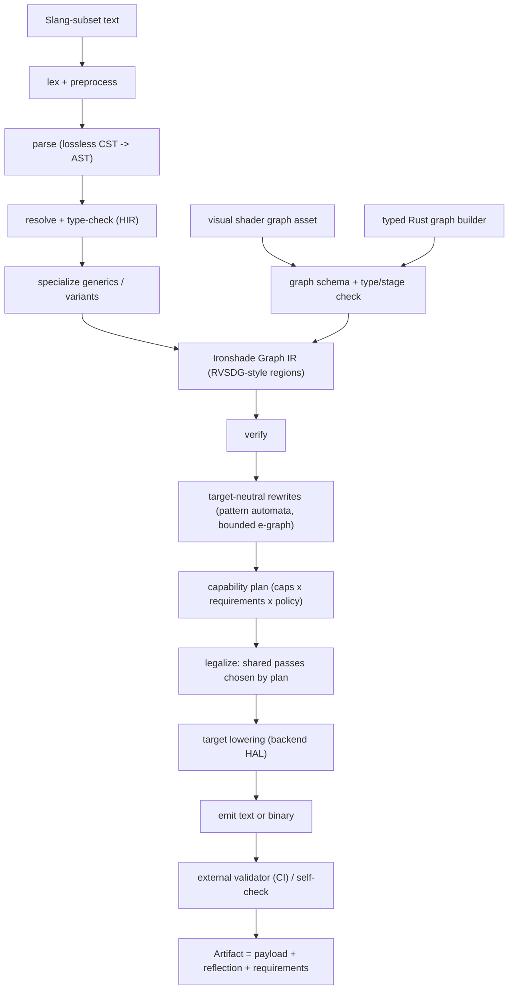
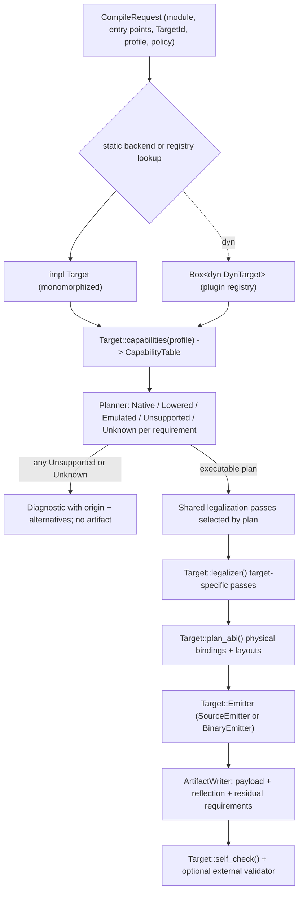
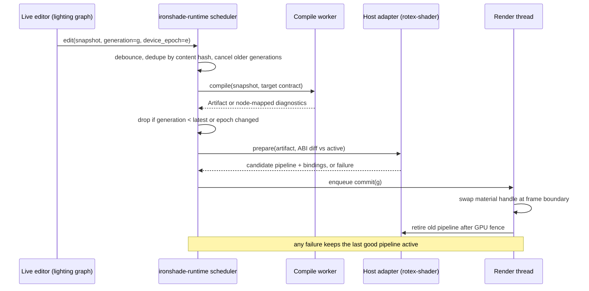
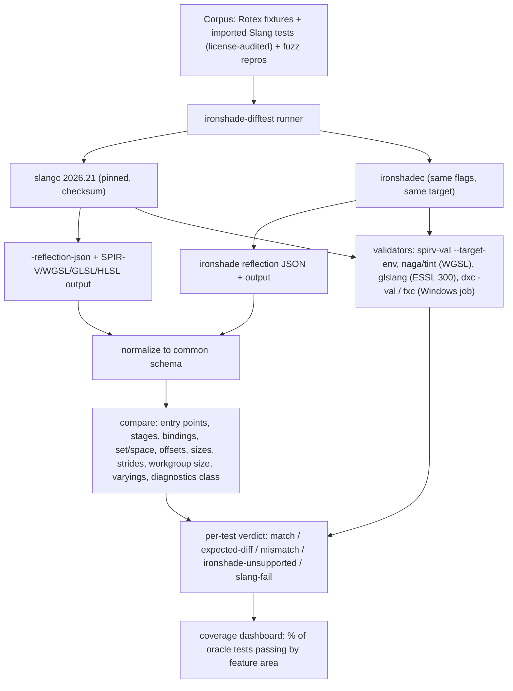
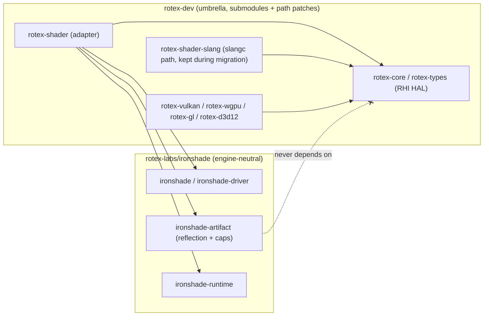
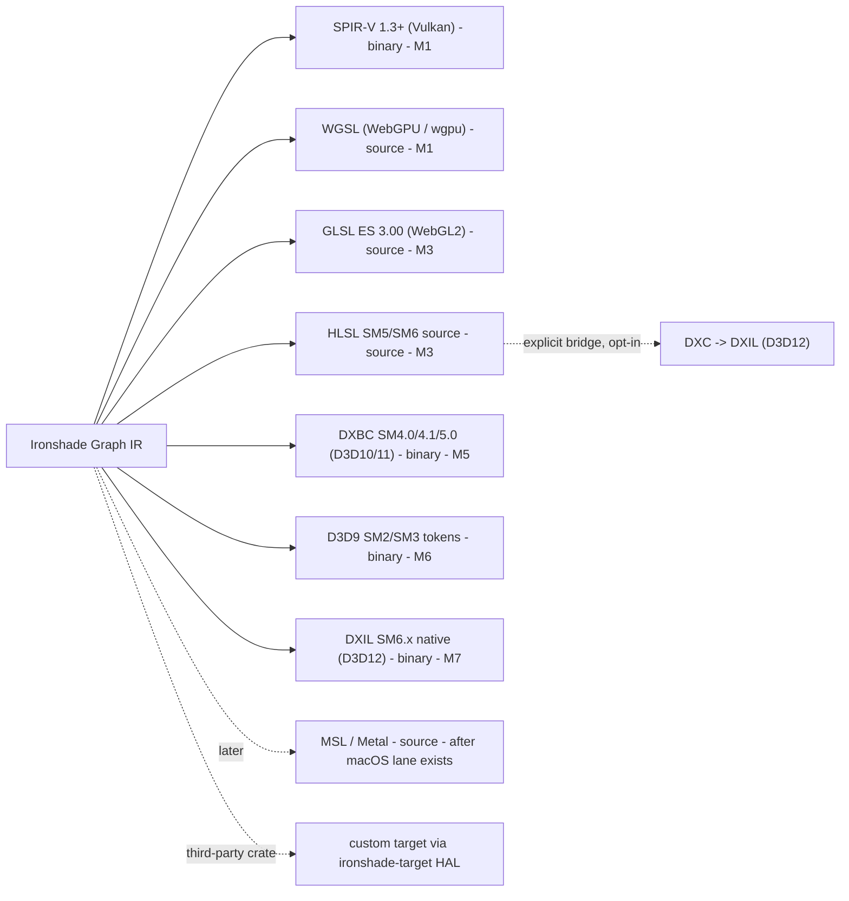

# Ironshade — Architecture and Repository Plan

> This document records the original architecture proposal. See the [repository README](../README.md) for current implementation status.

**What this is:** a planning document for **Ironshade**, a clean-slate, pure-Rust shader compiler that aims to compile the Slang™ shading language. Ironshade is by Ammar S / rotex-labs and was built for the Rotex engine, but it does not depend on Rotex.
**Status:** proposal only. No repository, crate or API described here exists yet. The Rust code below shows intended shapes; it has not been compiled.
**Researched:** 11 November 2026 (Asia/Amman). The sources in §17 were opened on that date. Crate, npm, PyPI and GitHub name checks in [S20] were re-run on 13 November 2026.
**Supersedes:** `rotex-native-shader-plan/ROTEX_NATIVE_SHADER_ARCHITECTURE.md`. This plan keeps that document's contracts: no silent dropping, the same semantics for text and graph input, reflection that survives into the RHI, and a runtime compiler as a real library. It renames the project, moves it into its own engine-neutral repository, replaces "structured SSA" with a graph IR, and turns the "provider contract" into an explicit backend HAL.

---

## 0. Decisions at a glance

| Topic | Decision |
|---|---|
| Name | **Ironshade**. A standalone product brand in the rotex-labs ecosystem, not a `rotex-` prefix. The umbrella library crate is **`ironshade`**; the CLI is **`ironshadec`**; the other libraries are **`ironshade-*`**. Naming history is in the naming note in §13. The `ironshade-*` names are distinct from the existing `rotex-shader-*` crates and do not collide with them [S20]. |
| Trademark | "Slang" is not used in any crate or product name. Wording is nominative: "aims to compile the Slang™ shading language". The README carries the notice "Slang™ and the Slang logo are trademarks of the Khronos Group Inc." [S2]. Ironshade never uses "conformant", "compliant", "supports", or "full implementation" about Slang [S3] (see §13). |
| Hosting | GitHub `rotex-labs/ironshade`. The compiler lives in its own engine-neutral repository, not inside `rotex-dev`. |
| Coupling | Ironshade has **no** dependency on `rotex-types`, `rotex-core`, or any `rotex-*` crate. `rotex-shader` depends on Ironshade and adapts its artifacts into Rotex shader packages. |
| Language goal | Full Slang language coverage over time, delivered feature by feature in dependency order. Progress is a **measured pass rate against the pinned Slang test suite**, not a date. |
| Core IR | **Ironshade Graph IR (IGIR)**, an RVSDG-style regionalized dataflow graph [S10]. Pure value nodes, explicit state edges, and structured γ (gamma: branch), θ (theta: loop), λ (lambda: function), and δ (delta: global) regions. Rewriting is pattern-based, using compiled match automata and an optional bounded e-graph [S11]. |
| Two frontends | The Slang-subset text frontend and the visual/typed shader graph both lower into IGIR. Nothing downstream can tell them apart. |
| Backends | A **backend HAL** (`ironshade-target`) instead of hardcoded targets. A backend implements `Target` and declares a `CapabilityTable` (Native / Lowered / Emulated / Unsupported / Unknown, plus numeric limits). The planner selects shared legalization passes. Each backend emits through a `SourceEmitter` or `BinaryEmitter`, and an `ArtifactWriter` attaches reflection. Dispatch is static and monomorphized by default, with an optional `dyn` registry for plugins. Third parties add a backend in their own crate. |
| Oracle | **slangc 2026.21**, the version `rotex-shader-slang` downloads today, pinned by SHA-256. The differential harness compares reflection, layouts, entry points, diagnostics, and validator results. Slang's `tests/` directory is the conformance oracle, after a licence audit (§10.6). |
| First proof | **M1:** Nova's seven entry points compile to SPIR-V and WGSL. Their reflection and layouts match slangc, and the output passes `spirv-val` and naga validation. |
| Release | `release-plz` with a single `version_group` for all published crates [S19]. `rotex-dev` pins Ironshade as a submodule with `[patch]` path overrides and an exact version match, enforced in CI (§11). |

---

## 1. Goals, non-goals, hard rules

**Goals**
1. Compile, natively in Rust and with only `cargo` as the build tool, a growing subset of the Slang language. The end goal is the whole language.
2. Reach targets that Slang either doesn't reach or handles badly: D3D9 SM2/3, D3D10 DXBC SM4.x, and WebGL2 ESSL 3.00. Mainstream targets are SPIR-V, WGSL, HLSL, and DXIL.
3. Be embeddable: a runtime compiler for live edits, buildable for `wasm32` so it can run in a browser worker.
4. Make every backend pluggable through a versioned HAL. Adding a target never requires forking Ironshade.

**Non-goals for now:** CUDA, CPU/C++ output, OptiX, ray tracing, mesh shaders, work graphs, the neural and cooperative-matrix features, and the language server. They are not rejected; they come after the core language. Ironshade also won't depend on Naga, Tint, or Slang at runtime. Those tools are used only as test oracles.

**Hard rules, carried over from the previous plan**
1. **No silent dropping.** Every requirement resolves to Native, Lowered, Emulated (with explicit policy approval), or a diagnostic. Unknown support is never treated as Native.
2. **One semantic model.** Text and graph input share types, resources, effects, capabilities, and layouts.
3. **Lossless reflection.** Artifacts carry requirements, type layouts, binding remaps, and environment identity all the way to the RHI.
4. **Compiler ≠ driver.** Shader compilation, API pipeline creation, and driver code generation are separate stages, and each is reported separately.
5. **Determinism.** The same inputs, compiler version, and target contract produce byte-identical output, using stable hashing and no hash-map iteration order.

---

## 2. Repository layout

One Cargo workspace in one repository, `rotex-labs/ironshade`. Split into crates only where there is a public contract or an optional dependency; everything else is a module inside a crate.

```text
ironshade/
├── Cargo.toml                    # [workspace], workspace.package.version, workspace.dependencies
├── release-plz.toml              # version_group = "ironshade" for every published crate
├── rust-toolchain.toml           # pinned stable; nightly only for fuzz/
├── deny.toml                     # cargo-deny: licences, advisories, duplicate deps
├── README.md                     # nominative Slang wording + Khronos notice (§13)
├── LICENSE-APACHE, LICENSE-MIT   # dual licence for Ironshade's own code
├── NOTICE                        # third-party attributions (imported tests, spec tables)
├── crates/
│   ├── ironshade/              # umbrella library crate + `ironshadec` CLI binary; re-exports a curated API
│   ├── ironshade-base/         # spans, source map, diagnostics, interner, arenas, stable hashing
│   ├── ironshade-syntax/       # lexer, preprocessor, lossless CST, AST (Slang-subset grammar)
│   ├── ironshade-sema/         # name resolution, modules, types, overloads, generics/interfaces -> HIR
│   ├── ironshade-stdlib/       # Ironshade-owned core-module declarations + intrinsic table (versioned)
│   ├── ironshade-ir/           # IGIR: nodes, regions, types, effects, builder, verifier, text dump/parse
│   ├── ironshade-rewrite/      # rewrite-rule DSL, compiled match automata, bounded e-graph engine
│   ├── ironshade-passes/       # target-neutral + shared legalization passes, pass manager
│   ├── ironshade-abi/          # logical->physical binding/layout planner (std140/std430/scalar/cbuffer/D3D9 regs)
│   ├── ironshade-caps/         # capability vocabulary, CapabilityTable, requirement inference, planner
│   ├── ironshade-target/       # BACKEND HAL: Target, Legalizer, Emitter, ArtifactWriter traits; registry; testkit
│   ├── ironshade-artifact/     # artifact container + reflection schema (serde, versioned); tiny, no compiler deps
│   ├── ironshade-graph/        # visual/typed shader graph schema, migrations, checked Rust builder -> IGIR
│   ├── ironshade-driver/       # session, incremental query cache, request pipeline, backend selection
│   ├── ironshade-runtime/      # live compile service: workers, generations, cancellation, ABI diff
│   ├── ironshade-spirv/        # backend: SPIR-V binary (Vulkan env), M1
│   ├── ironshade-wgsl/         # backend: WGSL source (WebGPU/wgpu), M1
│   ├── ironshade-glsl/         # backend: GLSL ES 3.00 source (WebGL2); desktop GLSL later, M3
│   ├── ironshade-hlsl/         # backend: HLSL source, SM4–SM6 dialects, M3
│   ├── ironshade-dxbc/         # backend: DXBC binary SM4.0/4.1/5.0 (D3D10/11), M5
│   ├── ironshade-d3d9/         # backend: D3D9 SM2/SM3 token-stream binary, M6
│   ├── ironshade-dxil/         # backend: DXIL SM6.x binary (D3D12), M7
│   └── ironshade-bridge-dxc/   # OPTIONAL, explicit: HLSL -> DXC -> DXIL until ironshade-dxil is ready
├── tools/
│   ├── ironshade-difftest/     # slangc-vs-ironshade differential runner + normalizer (§10)
│   ├── ironshade-conformance/  # Slang test-suite importer, //TEST directive parser, dashboard generator
│   └── ironshade-reduce/       # test-case reducer for mismatches/crashes (delta debugging over CST)
├── xtask/                        # cargo xtask: fetch-oracles, conformance, dashboard, bless, check-layering
├── tests/
│   ├── fixtures/rotex/           # Nova, cube, boids, particles … (copied, origin commit recorded)
│   ├── fixtures/lang/            # Ironshade-authored per-feature positive/negative tests
│   ├── snapshots/                # insta snapshots: IGIR dumps, WGSL/GLSL/HLSL, SPIR-V disasm, reflection JSON
│   └── abi-probes/               # struct layout probes (offset/stride tables), host-packing checks
├── conformance/
│   ├── slang-tests/              # git submodule of shader-slang/slang at the pinned tag (tests/ used)
│   ├── manifest.toml             # pinned tag, commit, oracle SHA-256s, per-directory licence audit, include/exclude
│   ├── features.toml             # test -> feature-area mapping (expressions, structs, generics, …)
│   ├── expected/                 # per-target expected-diff overrides (reason + tracking issue)
│   └── dashboard/                # generated JSON + static HTML coverage report (CI artifact / gh-pages)
├── fuzz/                         # cargo-fuzz targets (nightly, Linux/macOS only) [S18]
│   ├── fuzz_targets/{lex,parse,sema,ir_text,graph_json,spirv_roundtrip,artifact_decode}.rs
│   └── corpus/                   # seeded from fixtures + conformance
├── docs/
│   ├── language-subset.md        # per-feature table: implemented / recognized-but-rejected / not parsed
│   ├── ir.md                     # IGIR invariants, node catalogue, verifier rules
│   ├── backend-hal.md            # HAL contract, versioning rules, how to write a backend
│   ├── capabilities.md           # capability vocabulary and stability policy
│   ├── abi.md                    # layout modes, binding remap rules, per-target tables
│   ├── difftest.md               # harness usage, normalization rules, expected-diff policy
│   ├── trademark.md              # naming/wording rules (§13)
│   └── adr/                      # architecture decision records (0001-graph-ir, 0002-backend-hal, …)
├── examples/
│   ├── external-backend/         # sample third-party backend crate built only on ironshade-target
│   └── live-lighting/            # headless runtime-compile demo (no GPU), emits WGSL per edit
└── .github/workflows/
    ├── ci.yml                    # fmt, clippy, test (Linux/macOS/Windows), wasm32 build, MSRV
    ├── difftest.yml              # Linux: slangc + spirv-val + naga + glslang; Windows: + dxc / fxc
    ├── conformance.yml           # nightly: full imported Slang suite, publishes dashboard
    ├── fuzz.yml                  # nightly time-boxed fuzzing, uploads crashes as artifacts
    └── release-plz.yml           # release PR + publish
```

**Why these boundaries.** `ironshade-artifact` and `ironshade-caps` are deliberately small and dependency-light. `rotex-shader`'s AOT loader can then read artifacts without building the compiler. Each backend is its own crate so that feature flags can actually drop the code. `ironshade-ir` is a separate crate because the graph frontend, the passes, and every backend build on it. It is versioned in lock-step with the rest, not as a promised-stable external IR (§12).

---

## 3. Crate dependency graph

*Diagram `01-crate-graph` ([Mermaid source](diagrams/01-crate-graph.mmd))*



Rules enforced in CI with `cargo deny` bans and an `xtask check-layering` script:
- Backends depend on `ironshade-target` (which re-exports the parts of `ironshade-ir`, `ironshade-caps`, `ironshade-abi`, and `ironshade-artifact` they need), never on `ironshade-sema`, `ironshade-syntax`, or `ironshade-graph`. A backend cannot see the frontend.
- `ironshade-artifact` depends only on `ironshade-base` plus `serde`. It is the durable compatibility surface.
- `ironshade-graph` and `ironshade-sema` both target `ironshade-ir`. Neither depends on the other. Graph nodes that call text functions go through `ironshade-driver`, which compiles the text module and exposes its functions as typed graph-callable signatures.
- Nothing in `crates/` depends on `tools/`, `xtask`, or any `rotex-*` crate.

---

## 4. Compilation pipeline

*Diagram `02-pipeline` ([Mermaid source](diagrams/02-pipeline.mmd))*



| Stage | Crate | Output | Notes |
|---|---|---|---|
| Lex + preprocess | `ironshade-syntax` | token stream with expansion provenance | `#define`, `#if/#ifdef/defined()`, `#include` via a host-supplied virtual file system. No ambient filesystem or network access. Expansion and include-depth budgets. Nova already relies on `#if !defined(ROTEX_WGSL)`. |
| Parse | `ironshade-syntax` | lossless CST → AST | Recursive descent for declarations and statements, Pratt parsing for expressions, error recovery. Attributes (`[shader("compute")]`, `[numthreads]`, `[[vk::binding]]`, `[[vk::push_constant]]`, `[[vk::location]]`) are parsed generically and validated in sema. |
| Sema | `ironshade-sema` | typed HIR | Modules, overloads, implicit-conversion ranking, l-values, semantics (`SV_*`, `TEXCOORDn`), resource types, stage legality, constant evaluation with shader semantics. Later: generics, interfaces, `extension`, associated types. |
| Specialize | `ironshade-sema` | concrete HIR per entry point | Bounded monomorphization. Preprocessor variants and specialization constants are part of the cache key. |
| Lower | `ironshade-sema` / `ironshade-graph` | IGIR module | The two frontends converge here. |
| Verify | `ironshade-ir` | — | Runs at ingress, after every pass in debug builds and CI, and before emission. A verifier failure is an internal compiler error, never "unsupported GPU". |
| Optimize | `ironshade-passes` + `ironshade-rewrite` | IGIR | Target-neutral rewrites under budgets (§5.3). |
| Plan | `ironshade-caps` | `CompilePlan` | Requirements × backend `CapabilityTable` × policy (§7). |
| Legalize | `ironshade-passes` + backend | target-legal IGIR | Shared passes chosen by the plan, then the target's own passes (§6.3). |
| ABI | `ironshade-abi` + backend | physical bindings and layouts | §8. |
| Emit | backend | text or binary payload | §6.4. |
| Write artifact | `ironshade-target::ArtifactWriter` | `ironshade_artifact::Artifact` | Payload, reflection, residual requirements, provenance. |

---

## 5. IR: Ironshade Graph IR (IGIR)

### 5.1 Why a graph IR, and why RVSDG-style

You want graph rewriting and automata-style processing at the centre of the compiler. A shader graph is already a dataflow graph, so the IR should be one too. But every important target is **structured**. WGSL, GLSL, and HLSL have no `goto`. SPIR-V for Vulkan requires structured control flow with merge declarations [S6]. D3D9/DXBC flow control is structured too. A sea-of-nodes or CFG IR would force a fragile re-structuring step on every source target.

The **RVSDG** (Regionalized Value State Dependence Graph) design resolves this [S10]. It is a dataflow graph whose control flow is *nested regions*:

| IGIR construct | RVSDG term | Meaning |
|---|---|---|
| `Simple` node | simple node | Pure operation (arithmetic, construct, swizzle, sample-with-explicit-LOD …) or effectful operation threaded through state edges |
| `Gamma` region | γ | `if` / `switch`. N sub-regions, one predicate, explicit outputs. Lowers directly to structured selection |
| `Theta` region | θ | Tail-controlled loop with loop-carried values as region arguments/results. `for` and `while` lower here, with explicit `break`/`continue` exits |
| `Lambda` region | λ | Function, including entry points with their stage interface |
| `Delta` region | δ | Global or constant (resources, `static const`) |
| `Phi` region | φ | Mutual recursion. Unsupported on shader targets: diagnosed by capability, kept for CPU-side constant evaluation only |

Properties this buys:
- **Structure is never lost**, so source emitters print regions as `if`/`loop` and SPIR-V emits `OpSelectionMerge`/`OpLoopMerge` straight from the region tree. No structurizer is needed on the main path.
- **Effects are explicit edges.** Memory reads/writes, `discard`, barriers, derivatives, atomics, and texture writes are ordered by *state* edges (`mem`, `io`, `ctrl`), not by position in a block. Pure nodes float freely, which makes rewriting simple and safe.
- **The visual shader graph is almost the IR already.** Graph nodes become simple nodes, graph conditionals become γ, and graph loops become θ.
- **Uniformity and derivatives become dataflow facts.** Uniformity analysis is a forward graph propagation, needed for WGSL's uniformity rules [S7] and for derivative and implicit-LOD legality.

### 5.2 Representation

- Nodes, regions, and edges live in per-function arenas with typed `Id<T>` handles. Ports are typed. Public construction goes only through `ironshade_ir::Builder`, which checks types and region scoping, so arbitrary structs can't produce an unverified module.
- Type system: scalars with width and signedness (`bool`, `i/u 8–64`, `f16/f32/f64`), vectors, matrices with explicit major-ness and multiplication semantics, fixed and runtime arrays, structs, pointers with address space and access, resource types (buffer kinds, texture dimension, sample type, MS, format, comparison), samplers, and opaque handles.
- Every node carries **provenance**: a list of `Origin`s (source span, macro expansion chain, graph node ID, pass that created it). Provenance survives inlining and specialization, so diagnostics always point at the user's text or graph node.
- A textual form (`.igir`) is used for golden tests and for fuzzing the verifier. It has a parser, so pass tests run IR → pass → IR without the frontend.
- Requirements are inferred per node (`requires: [Cap::Float64, Cap::Derivatives{stage: Fragment}]`) and aggregated per entry point.

### 5.3 Rewriting engine (`ironshade-rewrite`)

- **Declarative rules:** `rule fold_mul_one: (fmul ?x (const 1.0)) => ?x where policy.allows(IdentityFold)`. Rules are Rust macros or a small DSL. Each rule declares the numerical policy it needs (strict versus fast math).
- **Compiled matching automaton:** all active rules compile into one discrimination tree, a tree automaton over node opcodes and port arity. Matching then costs about one pass per node, regardless of how many rules there are. That is the "automata" part. Legalization recipes are rule sets, so a target's lowering is "apply rule set X to fixpoint, then verify".
- **Bounded equality saturation (optional):** for pure regions only, an e-graph in the style of egg [S11] explores rewrites and extracts the cheapest form under a target cost model (for example, D3D9's instruction-slot count). It has hard node, iteration, and time budgets, and every fixpoint is verified afterwards. Effectful nodes are never put in the e-graph; it works per pure sub-graph between state edges. Ironshade implements its own small engine rather than depending on `egg` (keeping the engine under its own control is the point), but it borrows egg's rebuild and extraction design [S11].
- **Pass contract:** each pass declares its input dialect and invariants, its output invariants, which analyses it needs or invalidates, and its budget. The pass manager re-infers requirements after any pass that adds them (emulations often do).

Initial target-neutral passes: constant folding (with shader semantics), dead-node elimination, CSE via hash-consing of pure nodes, bounded inlining, γ-simplification (constant predicate), θ-invariant hoisting (effect-aware), and swizzle/construct canonicalization.

---

## 6. Backend HAL (`ironshade-target`)

This is the main structural difference from Slang, where each target is a hardcoded emitter path inside the compiler [S1, S4]. In Ironshade a backend is a crate that implements a trait contract, the same philosophy as the Rotex RHI HAL. The core compiler knows the contract; it knows no target by name.

*Diagram `03-backend-hal` ([Mermaid source](diagrams/03-backend-hal.mmd))*



### 6.1 Core traits (sketch)

```rust
// ironshade-target/src/lib.rs  (illustrative; HAL version 0.x)
pub const HAL_VERSION: HalVersion = HalVersion { major: 0, minor: 1 };

/// Stable, namespaced identity. Third parties use their own namespace.
#[derive(Clone, Copy, PartialEq, Eq, Hash, Debug)]
pub struct TargetId { pub namespace: &'static str, pub name: &'static str, pub revision: u32 }
// e.g. TargetId { namespace: "ironshade", name: "spirv", revision: 1 }

pub enum PayloadKind { Source { language: SourceLanguage }, Binary { format: BinaryFormat } }

/// A concrete environment the backend can be asked to produce for.
pub struct Profile {
    pub representation: Representation,   // Spirv{1,3} | Wgsl | Essl300 | Hlsl{sm} | Dxbc{4_0} | D3d9{vs_3_0} …
    pub environment: Environment,         // Vulkan{1,1} | WebGpu | WebGl2 | D3d11{fl:10_0} …
    pub extensions: SmallVec<[ExtensionId; 4]>,
    pub limits_override: Option<Limits>,  // caller's enabled-device limits, if known
}

/// The one trait a backend must implement. Associated types keep the hot path monomorphized.
pub trait Target: Send + Sync + 'static {
    type Legalizer: Legalizer;
    type Emitter: Emitter;
    type Options: Default + Clone + serde::Serialize + serde::de::DeserializeOwned;

    fn id(&self) -> TargetId;
    fn hal_version(&self) -> HalVersion { HAL_VERSION }
    fn payload_kind(&self) -> PayloadKind;
    fn profiles(&self) -> &[ProfileDescriptor];

    /// What THIS implementation can do for this profile. Unimplemented => Unsupported/Unknown.
    fn capabilities(&self, profile: &Profile, opts: &Self::Options) -> CapabilityTable;

    /// Target-specific legalization, run after the shared passes the planner selected.
    fn legalizer(&self, profile: &Profile, opts: &Self::Options) -> Self::Legalizer;

    /// Physical ABI planning: bindings, register classes, layouts (ironshade-abi helpers).
    fn plan_abi(&self, m: &LegalModule, profile: &Profile, policy: &AbiPolicy)
        -> Result<PhysicalAbi, Diagnostics>;

    fn emitter(&self, profile: &Profile, opts: &Self::Options) -> Self::Emitter;

    /// Cheap internal consistency check (SPIR-V header/ID bound, WGSL re-parse, …).
    fn self_check(&self, _payload: &Payload, _profile: &Profile) -> Result<(), Diagnostics> { Ok(()) }
}
```

```rust
/// Every known capability resolves to exactly one Support value.
pub enum Support {
    Native,
    Lowered     { recipe: RecipeId },                  // semantics-preserving rewrite
    Emulated    { recipe: RecipeId, cost: CostClass }, // needs explicit policy approval
    Unsupported { reason: &'static str },
    Unknown     { needs: QueryId },                    // depends on device facts not provided
}

pub struct CapabilityTable {
    pub caps: CapMap<Support>,       // dense map over the versioned Cap vocabulary (ironshade-caps)
    pub limits: Limits,              // max bindings per class, push/uniform bytes, workgroup size and
                                     // invocations, temp/instruction/const-register slots (D3D9) …
    pub layout_rules: LayoutRules,   // which of std140/std430/scalar/cbuffer/D3D9-regs are legal
    pub stages: StageSet,
}
// A Cap missing from `caps` reads as Unknown by construction: the table cannot "forget" to say no.
```

```rust
/// Shared legalization passes live in ironshade-passes and are referenced by RecipeId.
/// A backend's own passes implement the same trait.
pub trait Pass {
    fn name(&self) -> &'static str;
    fn contract(&self) -> PassContract;   // in/out dialect, invalidated analyses, budget
    fn run(&mut self, m: &mut ModuleMut, cx: &mut PassCx) -> Result<Changed, Diagnostics>;
}

pub trait Legalizer {
    /// Ordered target passes; the pass manager verifies between each in debug/CI.
    fn passes(&mut self) -> &mut [Box<dyn Pass>];   // cold path, dyn is fine here
    /// Final gate: every remaining node must be legal for the profile.
    fn check_legal(&self, m: &LegalModule) -> Result<(), Diagnostics>;
}

/// Emission. Source and binary backends share one trait; only the output type differs.
pub trait Emitter {
    type Output: Into<Payload>;
    fn emit(&mut self, m: &LegalModule, abi: &PhysicalAbi, cx: &mut EmitCx)
        -> Result<Self::Output, Diagnostics>;
}
pub trait SourceEmitter: Emitter<Output = SourceText> {}   // WGSL, ESSL, HLSL, MSL
pub trait BinaryEmitter: Emitter<Output = BinaryBlob> {}   // SPIR-V, DXBC, D3D9 tokens, DXIL

/// Shared, not per-backend: builds the artifact from plan + ABI + payload, so every
/// backend produces the same reflection schema and none can omit requirements.
pub struct ArtifactWriter { /* schema version, provenance policy */ }
impl ArtifactWriter {
    pub fn write(&self, target: TargetId, profile: &Profile, plan: &CompilePlan,
                 abi: &PhysicalAbi, payload: Payload) -> Result<Artifact, Diagnostics> { todo!() }
}
```

Binary backends get helpers in `ironshade_target::binary`: word/token writers, ID allocators, chunked container builders (DXBC/DXIL), and checksum hooks. Source backends get `ironshade_target::source`: an indented writer, a name mangler with per-language reserved words, a precedence-aware expression printer, and line maps.

### 6.2 Static dispatch by default, registry when needed

```rust
// Static, monomorphized path (engines, CLI with compile-time features):
let artifact = ironshade_driver::compile::<ironshade_spirv::Spirv>(&session, &request, &spirv)?;

// Dynamic registry (editors, plugin hosts, CLI selecting by name):
pub trait DynTarget: Send + Sync { /* object-safe mirror of Target, type-erased Options */ }
impl<T: Target> DynTarget for T { /* blanket impl; Options via serde */ }

let mut reg = TargetRegistry::new();
#[cfg(feature = "spirv")] reg.register(ironshade_spirv::Spirv::default());
#[cfg(feature = "wgsl")]  reg.register(ironshade_wgsl::Wgsl::default());
reg.register(acme_ironshade_psp::Psp::default());          // third-party crate, no fork
let artifact = ironshade_driver::compile_dyn(&session, &request, reg.get("acme:psp")?)?;
```

- `DynTarget` has a blanket impl, so a backend author writes `Target` once and gets both paths.
- There is no dynamic library loading and no stable Rust ABI across DLLs. Plugins are Rust crates linked at build time. If out-of-process plugins are ever needed, they get a separate versioned, serialized protocol (IGIR text in, payload out) with size limits. That is out of scope for now.
- Hot loops (emitting nodes) are monomorphized inside each backend. The `dyn` boundary sits only at the request level, where its cost is negligible.

### 6.3 Shared legalization selected by capabilities

The planner, not the backend, chooses shared recipes. A backend's table says *how* it supports each capability, and the planner maps that to passes in `ironshade-passes`:

| Requirement in module | Backend says | Planner selects (shared pass) |
|---|---|---|
| `PushConstants` | SPIR-V: Native | none |
| `PushConstants` | WGSL baseline: `Lowered{push_to_uniform}` | `push_to_uniform`: reserved `@group/@binding` uniform, recorded in the ABI remap. Group/binding chosen to match slangc's output (measured in M1) |
| `PushConstants` | D3D11 HLSL/DXBC: `Lowered{push_to_cbuffer}` | `push_to_cbuffer` at a reserved `b` register |
| `PushConstants` | D3D9: `Lowered{push_to_const_regs}` | `push_to_const_regs`: `c#` float4 registers + upload map |
| `SeparateSampler` | ESSL 300 / D3D9: needs combined | `split_to_combined`: pairs (texture, sampler) uses. Can raise binding counts, so limits are re-checked |
| `StructuredBuffer` | ESSL 300: Unsupported | Diagnostic; no artifact |
| `stage.compute` | WebGL2, D3D9, D3D10: Unsupported | Diagnostic with the alternative "author a fragment-pass variant" |
| `type.i64` | D3D9 / WGSL: Unsupported | Diagnostic (no i32 substitution unless policy approves an approximate variant) |
| `builtin.point_size` | SPIR-V: Native; WGSL and DXIL SM6: Unsupported | Diagnostic, unless policy opts into `point_sprite_expand` (Emulated: vertex-pulled quad). This is the exact Nova `SV_PointSize` case |
| Dynamic loops | D3D9 `ps_2_0`: Unsupported; `ps_3_0`: Native within limits | `unroll_bounded`, only if a trip-count bound is provable and fits the slot limits |
| Derivative under non-uniform control | WGSL: Unsupported (uniformity rule) | Diagnostic pointing at the branch; optional `hoist_derivative` if provably equivalent |

After lowering, requirements are re-inferred and the plan is re-checked until it is stable (bounded rounds) or it fails.

### 6.4 Source versus binary backends

| | Source backends (WGSL, ESSL, HLSL, MSL) | Binary backends (SPIR-V, DXBC, D3D9, DXIL) |
|---|---|---|
| Output | `SourceText` + line map | `BinaryBlob` + disassembly for snapshots |
| Structure | Print γ/θ regions directly | SPIR-V: merge instructions from regions. DXBC/D3D9: structured flow tokens. DXIL: LLVM-3.7-era bitcode CFG + metadata [S13, S14] |
| Allocation | Names only | IDs (SPIR-V), virtual→physical temps (D3D9/DXBC), SSA values (DXIL) |
| Consumer | Driver or browser still compiles the text | Driver compiles from the IL |
| Self-check | Re-parse output with Ironshade's own reader for that language | Structural decode + ID/bound checks |
| CI validation | naga/Tint (WGSL), glslang (ESSL), dxc/fxc (HLSL) | `spirv-val --target-env vulkan1.x` [S16]; DXIL validation and D3D runtime creation on Windows |

**Transitional DXIL bridge:** `ironshade-bridge-dxc` is a *separate* backend, `TargetId{"ironshade","dxil-via-dxc",1}`. It is never a silent fallback. It runs `ironshade-hlsl` output through a user-supplied DXC. Its artifact records `external_compiler = "dxc <version>"`, and release notes list D3D12 as "own HLSL + external DXC" until `ironshade-dxil` takes over, one profile at a time.

### 6.5 Feature flags

```toml
# crates/ironshade/Cargo.toml
[features]
default     = ["spirv", "wgsl"]
spirv       = ["dep:ironshade-spirv"]
wgsl        = ["dep:ironshade-wgsl"]
glsl        = ["dep:ironshade-glsl"]
hlsl        = ["dep:ironshade-hlsl"]
dxbc        = ["dep:ironshade-dxbc"]
d3d9        = ["dep:ironshade-d3d9"]
dxil        = ["dep:ironshade-dxil"]
bridge-dxc  = ["dep:ironshade-bridge-dxc", "hlsl"]   # never in default
graph       = ["dep:ironshade-graph"]
runtime     = ["dep:ironshade-runtime", "graph"]
all-targets = ["spirv", "wgsl", "glsl", "hlsl", "dxbc", "d3d9", "dxil"]
```

Features are additive, as Cargo requires [S17]. No feature changes another backend's behaviour; `bridge-dxc` only adds a target.

### 6.6 Adding a third-party backend (no fork)

1. Create the crate `acme-ironshade-psp` depending only on `ironshade-target = "=0.N"` (exact HAL minor while in 0.x; see §12).
2. Implement `Target`: a `TargetId{namespace:"acme",…}`, profiles, and an honest `CapabilityTable`. Reuse shared recipes by `RecipeId` and add your own `Pass`es.
3. Implement `Emitter`, using the `ironshade_target::source` or `::binary` helpers.
4. Run the **backend testkit** (the `ironshade-target/testkit` feature). It checks that every `Cap` resolves, that Unsupported caps produce diagnostics and never artifacts, determinism, artifact schema completeness, and the golden fixture corpus. This mirrors how the Rotex RHI HAL tests backends.
5. Use the backend statically (`compile::<Psp>`) or register it in a `TargetRegistry`.

`examples/external-backend/` keeps this path compiling in CI, so the HAL can't quietly start needing private APIs.

---

## 7. Capability model (`ironshade-caps`)

Five layers, combined by the planner (unchanged in spirit from the previous plan):
1. **Language implementation:** which constructs Ironshade's frontend understands (`docs/language-subset.md`).
2. **Backend implementation:** the backend's `CapabilityTable` for the profile.
3. **API environment:** profile rules (stages, representation version, extensions).
4. **Enabled device:** optional `Limits` and feature facts from the host at runtime. When they are missing, results are `Unknown`, not Native.
5. **Policy:** which `Emulated` recipes are allowed, the numerical policy (strict-portable versus fast), and code-size budgets.

- **Vocabulary:** `Cap` is a versioned enum in `ironshade-caps` with stable string names, such as `stage.compute`, `type.f16`, `resource.structured_buffer.rw`, `builtin.point_size`, and `op.derivative.fine`. Adding a cap is a minor bump; renaming or removing one is a major bump. Third-party caps use `Cap::Ext("acme:psp.vfpu")`.
- **Requirements** are predicates with origins: `all/any`, stage restrictions, and numeric relations such as `fragment.sampled_textures <= limits.max_sampled_textures_per_stage` and `push_block_bytes <= limits.max_push_bytes` (Nova needs 64).
- **Report:** every compile produces a `CapabilityReport`, a list of (cap, origin, support, recipe, observed/required values). It is stored in the artifact and printable with `ironshadec explain`. For Nova on WGSL without the define, the report reads `builtin.point_size  nova_particle.slang:19  Unsupported  (policy may enable point_sprite_expand)`.
- **Mapping to Slang:** Slang has its own capability atoms [S1]. The difftest normalizer maps Slang's capability diagnostics to Ironshade `Cap`s, so "both refused for the same reason" counts as agreement.

---

## 8. ABI and reflection

- **Logical bindings** come from source (`[[vk::binding(b,s)]]`, `register(t0, space1)`, `ConstantBuffer<T>`, `[[vk::push_constant]]`) or from graph declarations. **Physical bindings** come from `Target::plan_abi`, with `ironshade-abi` helpers for each scheme:
  - SPIR-V/Vulkan: descriptor set and binding; push-constant block layout.
  - WGSL: `@group/@binding`, plus the reserved binding for lowered push constants.
  - HLSL/DXBC/DXIL: register classes `b/t/u/s` and spaces. Each class is packed sequentially per space, matching slangc's behaviour as observed in the Nova review (compute: `b0` push, `t0`/`t1` read-only buffers, `u0` read-write; composite: `t0` + `s0`).
  - ESSL 300: UBO block bindings, combined sampler units, attribute and varying locations.
  - D3D9: `c#`/`i#`/`b#` constant registers + `s#` samplers + an upload map.
- **Layouts:** std140, std430, scalar, D3D cbuffer packing (16-byte rows, no straddling), and D3D9 float4 registers. Each layout is a pure function from type to layout, covered by byte-probe tests.
- **Reflection schema** (`ironshade_artifact::Reflection`, JSON plus compact binary): entry points (name, stage, workgroup size), stage I/O (location, semantic, type, interpolation, builtins), resources (logical ID, physical binding, kind, access, array size, and type layout with every member's offset, size, stride, and matrix layout), push/constant blocks, specialization constants, the capability report, and remaps. **Declared and live** bindings are listed separately.
- A **normalizer to slangc's `-reflection-json`** [S4] lets the two compilers' reflection be compared field by field (§10).

---

## 9. Shader graph and runtime compiler

### 9.1 Graph (`ironshade-graph`)
- A versioned asset schema with stable node IDs and a migration chain. Node definitions are namespaced and versioned, with typed ports, a stage domain, effects, and the capabilities they require.
- A **typed Rust builder** with `Expr<T>` handles, for code-built graphs and the editor backend. Loaded assets are still validated dynamically.
- Lowering: pure nodes become IGIR simple nodes, branch nodes become γ, loop nodes become θ, and effectful nodes are threaded on state edges. Text functions become callable nodes through typed signatures exported by the driver.
- Uniform values, compile-time constants, and variant keywords are distinct, and keywords really do enter specialization. The review found that today's preset graph only counts keywords against the budget.
- The first node library is a material and lighting vocabulary: attributes, uniforms, math, texture sample, normal transform, Lambert, Blinn-Phong and GGX (as versioned library functions), and fragment output.

### 9.2 Runtime (`ironshade-runtime`)

*Diagram `05-runtime` ([Mermaid source](diagrams/05-runtime.mmd))*



- **Value edits** (light colour, intensity, roughness) only update uniforms. Nothing is recompiled.
- **Structural edits** (swap Lambert for GGX, add a normal-map node) trigger a recompile on worker threads, or a Web Worker on wasm. Compilation never runs on the render thread.
- **Generations:** every edit increments `g`. Results with `g < latest` are dropped. A device epoch blocks commits after device loss or recreation.
- **Debounce and dedupe** by content hash, using an incremental query cache in `ironshade-driver`. Unchanged modules and the stdlib are not re-checked. Cancellation is cooperative and is checked between passes.
- **ABI diff:** the new `PhysicalAbi` is compared with the active one. *Same interface* → swap the pipeline. *Migratable* → the host supplies the new resources and layouts, committed atomically. *Rejected* → diagnostic, and the old pipeline stays.
- **Host adapter trait**, implemented by `rotex-shader`, not by Ironshade:

```rust
pub trait PipelineHost {
    type Candidate;
    fn prepare(&self, artifact: &Artifact, diff: &AbiDiff) -> Result<Self::Candidate, HostError>;
    fn commit(&self, material: MaterialKey, candidate: Self::Candidate, generation: u64);
}
```

Ironshade owns compilation, generations, and diffs. The host owns pipelines, fences, and retirement. That split is what keeps Ironshade engine-neutral.

---

## 10. Checked against slangc: differential and conformance harness

*Diagram `04-difftest` ([Mermaid source](diagrams/04-difftest.mmd))*



### 10.1 Oracle pinning
- `cargo xtask fetch-oracles` downloads **slangc 2026.21** from the same URL `rotex-shader-slang` uses (`https://github.com/shader-slang/slang/releases/download/v2026.21/slang-2026.21-linux-x86_64.tar.gz`, plus the Windows asset). It verifies the SHA-256 recorded in `conformance/manifest.toml` and caches the result. Upgrading the oracle is a deliberate PR that re-baselines expectations. Upstream is already at **v2026.22** (published 10 Nov 2026, 22:28 Asia/Amman) [S5]; bump only together with `rotex-shader-slang`.
- The same mechanism pins `spirv-val` (SPIRV-Tools), `naga-cli` (30.0.1 on crates.io as of 11 Nov 2026), and `glslangValidator`. On Windows it also pins `dxc`, and takes `fxc` from the Windows SDK.

### 10.2 What is compared

| Axis | How | Pass rule |
|---|---|---|
| Entry points | names, stages, `numthreads` | exact |
| Resource bindings | slangc `-reflection-json` [S4] vs Ironshade reflection, both normalized | same set, binding/space, kind, access, array size |
| Struct layouts | member offset, size, stride, alignment, matrix layout | exact (Nova: `SimPush` 0..60 step 4 = 64 B; `Particle` 0, 8; `Well` 0, 8, 12) |
| Push/constant blocks | size, members, and the reserved binding on lowered targets | exact, or a documented expected-diff |
| Stage I/O | locations, semantics, builtins, interpolation | exact |
| Output validity | every output through its validator for the declared environment | Ironshade must pass; slangc's result is recorded |
| Diagnostics | success vs error, and the **class** of error (syntax, type, capability, limit) | same class; wording and codes are not compared |
| Behaviour (later, optional GPU lane) | compute readback or image diff | within tolerance |

Emitted text (WGSL, HLSL) is **not** diffed against slangc's text; formatting and naming will differ. It is compared semantically instead: reflection must match and validators must pass. SPIR-V is compared through reflection and validation, not byte equality.

### 10.3 Verdicts
- `match`
- `expected-diff`: listed in `conformance/expected/*.toml` with a reason and an issue link.
- `mismatch`: a failure.
- `ironshade-unsupported`: Ironshade emitted a capability or subset diagnostic. Counts as *not covered*, not as failed.
- `oracle-fail`: slangc itself fails. Excluded from the denominator and recorded.
- `crash`: always a failure.

### 10.4 Importing Slang's test suite
- Slang's tests are `.slang` files with `//TEST(category):TYPE:args` headers, run by `slang-test`. The types include `SIMPLE` (run slangc with args), `REFLECTION`, `COMPARE_COMPUTE`, `COMPARE_RENDER_COMPUTE` and others. Tests are disabled with `//DISABLE_TEST`, and there are per-platform expected-failure lists [S8].
- `ironshade-conformance` parses those headers and maps each test to a difftest job:
  - `SIMPLE` and `REFLECTION` → compile-only differential, no GPU needed. Available from M0.
  - `COMPARE_COMPUTE*` → compile differential now. GPU readback comes later in an optional lane, with the expected-output files as the oracle.
  - Render and API-specific tests (CUDA, OptiX, Metal, ray tracing) → `not-applicable` until a matching target exists.
- `features.toml` maps directories to feature areas: `front-end/`, `preprocessor/`, `parser/`, `type/`, `language-feature/`, `generics/`, `modules/`, `autodiff/`, `spirv/`, `wgsl/`, `hlsl/`, `bindings/`, `reflection/`, `compute/` … All of these exist in upstream `tests/` today [S9].

### 10.5 Coverage dashboard: the progress metric
For each feature area and target, **coverage = match ÷ (applicable − oracle-fail)**, with separate counts for `ironshade-unsupported` and `mismatch`. `conformance.yml` publishes it nightly as JSON and static HTML. A milestone is done when its areas reach their thresholds (§14–15). This number takes the place of any calendar estimate.

### 10.6 Licensing of imported tests (verified)
- Slang's top-level `LICENSE` is **`Apache-2.0 WITH LLVM-exception`** [S5a]. Reusing or vendoring its tests is allowed, provided the licence text, attribution, and a notice of any modifications are kept.
- **Not every file is under that licence.** `tests/fcpw/` has its own **MIT** licence (Copyright 2020 Rohan Sawhney) [S9]. `conformance/manifest.toml` therefore records a licence audit per directory, and `xtask conformance --audit` fails when an imported directory contains a `LICENSE` or `COPYING` file without a recorded decision.
- Preferred mechanism: a **git submodule at the pinned tag**, so the tests are referenced rather than copied and provenance stays clean. Files are copied only for small adapted fixtures, each with a header naming its origin path and commit, and `NOTICE` lists the attributions.
- Ironshade's own code is licensed MIT OR Apache-2.0. The LLVM exception only matters when Slang *code* ends up embedded in object form, and Ironshade embeds none.

### 10.7 Other test layers
- **Golden snapshots** with `insta` (1.49.0 on 11 Nov 2026) [S12]: IGIR dumps, emitted text, SPIR-V disassembly, and reflection JSON. `cargo xtask bless` wraps `cargo insta review`.
- **Fuzzing** with `cargo-fuzz` [S18]. It needs nightly and runs only on Unix-like hosts (x86-64/AArch64), which suits a nightly Linux job. Targets: the lexer, parser, and sema (no panics, budgets respected), the IGIR text parser and verifier, graph JSON, the artifact decoder (untrusted input), and an IR → SPIR-V → `spirv-val` round trip over generated well-typed programs. Crashes are minimized with `ironshade-reduce` and added to the corpus.
- **Metamorphic tests:** dead-code insertion, re-association under the strict policy (which must be refused), and graph-versus-text equivalence for the lighting library.
- **ABI probes:** generated structs under each layout rule, checked against slangc reflection and against hand-computed tables.

### 10.8 CI matrix (compile tests need no GPU)

| Job | Runner | Runs |
|---|---|---|
| `ci` | ubuntu, macos, windows | fmt; clippy `--all-features`; tests; docs; `wasm32-unknown-unknown` build of `ironshade` (no default features) and `ironshade-runtime`; MSRV |
| `difftest-linux` | ubuntu (PR gate) | slangc 2026.21 + spirv-val + naga + glslang over `tests/fixtures` |
| `difftest-windows` | windows | adds dxc/fxc validation of HLSL, DXBC, and DXIL payloads plus the DXC bridge. Optional D3D12/D3D11 WARP shader-creation smoke test; this is not proof of correctness or performance on real hardware |
| `conformance` | ubuntu, nightly | full imported Slang suite → dashboard; a regression opens an issue |
| `fuzz` | ubuntu, nightly | time-boxed run per target |
| `layering` | ubuntu | `cargo deny`, `xtask check-layering`, and `examples/external-backend` built against the public HAL only |
| `release-plz` | ubuntu | release PR and publish |

GPU and native-API correctness (Vulkan validation layers, D3D12 on real hardware, browsers) belongs to Rotex's integration lanes, not to Ironshade's required CI.

---

## 11. Rotex integration

*Diagram `06-rotex-integration` ([Mermaid source](diagrams/06-rotex-integration.mmd))*



- `rotex-shader` gets an **`ironshade` provider** beside the existing `rotex-shader-slang` provider, and both produce the same Rotex `ShaderPackage`. During migration they stay sibling providers; later, `rotex-shader-slang` may wrap or defer to Ironshade if that becomes the preferred path. The adapter maps `ironshade_artifact::Reflection` to Rotex binding layouts and **fills `type_layouts`**, closing the empty-layout gap found in review. It also maps the `CapabilityReport` to Rotex capability status, so an Unsupported capability becomes a load-time error rather than a silent no-op. The `ironshade-*` crates do not replace `rotex-shader-core`, `rotex-shader-cooker`, `rotex-shader-graph`, or `rotex-shader-slang`.
- **Migration:** a `rotex-dev` CI job runs both providers on every Rotex shader. An example moves to Ironshade only once its entry points reach `match` on every target it ships. slangc stays available as an explicit per-package channel. It is never selected automatically when Ironshade fails.
- **Submodule wiring in `rotex-dev`** (Ironshade checked out at `slices/ironshade`):

```toml
# rotex-dev/Cargo.toml
[workspace.dependencies]
ironshade          = { git = "https://github.com/rotex-labs/ironshade", version = "=0.3.0" }
ironshade-artifact = { git = "https://github.com/rotex-labs/ironshade", version = "=0.3.0" }
ironshade-runtime  = { git = "https://github.com/rotex-labs/ironshade", version = "=0.3.0" }

[patch."https://github.com/rotex-labs/ironshade"]
ironshade          = { path = "slices/ironshade/crates/ironshade" }
ironshade-artifact = { path = "slices/ironshade/crates/ironshade-artifact" }
ironshade-runtime  = { path = "slices/ironshade/crates/ironshade-runtime" }
# one line per ironshade crate any rotex crate depends on
```

- **Avoiding a repeat of the `rotex-ext-indirect` break.** That break happened because a stale git dependency's version requirement didn't match the patched path crate, so Cargo skipped the patch and compiled the old crate [S15]. The guards:
  1. All Ironshade crates share one version (`version_group`), so a submodule bump moves every crate together.
  2. Every `rotex-*` crate takes Ironshade from `[workspace.dependencies]` (`ironshade.workspace = true`) and never pins its own rev. Extension slices such as `rotex-ext-indirect` follow the same rule.
  3. An `xtask check-patches` step in `rotex-dev` fails CI when `cargo metadata` resolves any `ironshade-*` package from a git or registry source instead of the path, or when Cargo warns that a patch was not used.
  4. The exact `=0.x.y` requirement is bumped in the same commit as the submodule pointer.

---

## 12. Versioning and release

- **Tooling:** `release-plz`, configured in `release-plz.toml`. Every published crate shares `version_group = "ironshade"`, so they all carry one version [S19]. `semver_check = true` for `ironshade-artifact`, `ironshade-target`, `ironshade-caps`, and `ironshade`. Changelogs come from conventional commits.
- **What is semver-stable:**
  - The `ironshade-artifact` schema has its own `SCHEMA_VERSION`. Loaders accept older minor schemas, and dropping a field needs a major bump.
  - The `ironshade-target` HAL carries `HAL_VERSION {major, minor}`. During 0.x, third-party backends pin `=0.N`. From 1.0, minor versions add trait methods with defaults, new `Cap`s, and new recipes; major versions change required methods. The registry rejects a backend whose `hal_version().major` differs from its own.
  - `Cap` names and `RecipeId`s are stable strings.
  - `ironshadec` CLI flags.
- **Not stable:** IGIR internals, pass APIs, and sema/HIR. They move in lock-step and are documented as internal; backend authors reach the parts they need only through `ironshade-target` re-exports.
- **First publish:** after M0, release a real `ironshade 0.1.0` with a description, repository link, and README, to reserve the name honestly. Don't publish an empty placeholder; crates.io discourages name-squatting.

---

## 13. Naming and trademark rules (`docs/trademark.md`)

- Product and crate names are **Ironshade**, the umbrella crate **`ironshade`**, the CLI **`ironshadec`**, and the libraries `ironshade-*`. "Slang" never appears in a name, logo, or domain.
- README lead, nominative: *"Ironshade is a pure-Rust shader compiler that aims to compile the Slang™ shading language to SPIR-V, WGSL, GLSL ES, HLSL and legacy Direct3D bytecode."*
- Required notice in the README and the docs footer: *"Slang™ and the Slang logo are trademarks of the Khronos Group Inc."* [S2].
- These words are banned until an official Khronos conformance process exists and Ironshade passes it as an Adopter: "conformant", "compliant", "complies with", "supports Slang", and "full implementation" [S3]. Write instead: "accepts the language subset listed in docs/language-subset.md" and "passes N% of the Slang compiler's own test suite (pinned v2026.21) under Ironshade's differential harness". Call the suite the "Slang compiler test suite", never "Slang conformance tests".
- The previous research turn found that the Slang trademark covers compilers for a 3D graphics programming language (US reg. 8330806, registered 7 July 2026) [S2b]. The registry page could not be re-fetched today. Before any commercial use, ask Khronos to confirm the wording.

**Naming note.** Ironshade is the chosen name. Argot was dropped because of the ARGOT COLLECTIVE trademark. rotex-slc was an interim name. A preliminary screen found no class 9/42 IRONSHADE mark; the off-domain uses found were shutters and a small game. This is not legal advice.

---

## 14. Language roadmap (dependency order)

| Area | Contents | Gate (applicable Slang tests, SPIR-V + WGSL) |
|---|---|---|
| L1 Expressions and control flow | scalars, vectors, matrices, swizzles, operators, conversions, intrinsics used by Rotex fixtures, `if`/`for`/`while`/`switch`/ternary, `discard`, functions, `static const`, preprocessor | `front-end`, `preprocessor`, `parser`, expression-level tests ≥ 90% |
| L2 Structs and resources | structs, arrays, `ConstantBuffer<T>`, `StructuredBuffer`/`RW*`, `ByteAddressBuffer`, textures and samplers, push constants, attributes, semantics, entry-point parameters, `numthreads`, `groupshared`, barriers, atomics | `bindings`, `reflection`, `compute` (compile-only) ≥ 85% |
| L3 Generics | generic functions and structs, value generics, constraints, `where`, inference, specialization | `generics` ≥ 80% |
| L4 Interfaces and modules | `interface`, conformances, associated types, `extension`, `import`/`module`/`__include`, visibility, `ParameterBlock`; existentials and dynamic dispatch come late in L4 | `modules` and the interface parts of `language-feature` ≥ 80% |
| L5 Advanced types and ops | `f16`/`i64`/`f64` where targets allow, wave/subgroup ops, `inout`/`out` edge cases, operator overloading, `__subscript`, properties | per-area thresholds |
| L6 Autodiff (last) | `[Differentiable]`, `fwd_diff`/`bwd_diff`, `DifferentialPair`, custom derivatives, implemented as IGIR graph transforms (forward and reverse mode fit a dataflow graph naturally) | `autodiff` ≥ 70%, raised later |

The thresholds are starting targets and go up as each area matures. The dashboard reports exact percentages, and the README quotes them with the date and the pinned oracle version.

---

## 15. Milestones (measurable exit criteria, no dates)

### M0 — Skeleton and harness, before any backend
**Scope:**
- The workspace with every crate stub from §2.
- `ironshade-base` (spans, diagnostics) and the `ironshade-artifact` reflection schema v0 with JSON.
- The `ironshade-target` HAL traits, plus an `examples/external-backend` stub.
- `xtask fetch-oracles`: slangc 2026.21 checked by SHA-256, spirv-val, naga-cli, and glslang.
- `ironshade-difftest`, able to run **slangc alone** and normalize its `-reflection-json` output.
- The `ironshade-conformance` header parser and licence audit.
- CI jobs `ci`, `layering`, and an oracle-only `difftest-linux`.
- The `docs/` skeleton, ADR-0001 (IGIR) and ADR-0002 (backend HAL).

**Exit:**
- `cargo xtask difftest --oracle-only tests/fixtures/rotex` produces normalized reflection for every Nova entry point, and the snapshots are committed.
- `cargo xtask conformance --dry-run` classifies every `//TEST` in the pinned Slang `tests/`, with counts by type and category on the dashboard, and the licence audit passes.
- `examples/external-backend` builds against `ironshade-target` alone.

### M1 — Nova to SPIR-V and WGSL, matching slangc
**Corpus**, copied from `rotex-dev` @ `d6d7551` with the origin recorded:
- `nova_gravity.slang` / `computeMain`:
  - `[numthreads(256,1,1)]`.
  - `[[vk::push_constant]] ConstantBuffer<SimPush>`: 16 × 4-byte fields, **64 bytes**.
  - `StructuredBuffer<Particle>` at binding 0, `RWStructuredBuffer<Particle>` at 1, `StructuredBuffer<Well>` at 2.
  - Control flow: a `for` loop over wells and an early `return`.
  - A uint hash using xor, shifts, and wrapping multiply.
  - Intrinsics: `rsqrt`, `dot`, `length`, `cos`, `sin`, `abs`, `sign`.
- `nova_particle.slang` / `vertexMain`, `fragmentMain`:
  - A 16-byte `PointPush`.
  - Vertex inputs at locations 0 and 1, and a `TEXCOORD2` varying at location 0.
  - `SV_Position`, plus `SV_PointSize` on the SPIR-V path only.
  - `clamp`, `lerp`, `frac`, `sin`, and the ternary operator.
  - In the fragment shader: `SV_PointCoord`, `discard`, and `exp`.
  - The `#if !defined(ROTEX_WGSL) && !defined(ROTEX_DXIL)` variants.
- `nova_persist.slang`: a 16-byte `FadePush`, a full-screen vertex shader, and a constant fragment output.
- `nova_composite.slang`: `Texture2D<float4>` at binding 0 and `SamplerState` at binding 1, with `.Sample`, `max`, `smoothstep`, `pow`, and `length` for the Reinhard tonemap and vignette.
- `nova_live.slang` has the same shape as composite and serves as an extra fixture.

**Scope:**
- Language: L1 plus the L2 subset above.
- IR and passes: IGIR with γ/θ/λ/δ regions, the verifier, constant folding, and dead-node elimination.
- ABI: `ironshade-abi` with scalar/std430 layout for push and storage blocks, and std140 for WGSL uniforms.
- `ironshade-spirv`, targeting the Vulkan 1.1 environment. slangc 2026.21 warned "SPIR-V version too old", so record which SPIR-V version slangc actually emits and choose Ironshade's version deliberately.
- `ironshade-wgsl`, with the WGSL push-to-uniform recipe.
- A `builtin.point_size` Unsupported diagnostic on WGSL.

**Exit criteria**, all automated in `difftest-linux`:
1. All 7 Nova entry points (plus 2 from `nova_live`) compile with `ironshadec` to SPIR-V and WGSL, using the same `-D` defines Rotex passes.
2. `spirv-val --target-env vulkan1.1` passes on every module, and naga parses and validates every WGSL module.
3. Normalized reflection equals slangc 2026.21 on all of the following:
   - entry points and stages, including `LocalSize 256,1,1`;
   - every binding (set, binding, kind, access);
   - every struct member offset: `SimPush` 0..60 step 4 with size 64; `Particle` 0 and 8 with stride 16; `Well` 0, 8 and 12 with stride 16; `PointPush` and `FadePush` 0..12 with size 16;
   - stage I/O locations and builtins: `PointSize` and `PointCoord` present in SPIR-V and absent in WGSL.
4. For WGSL push constants, Ironshade's reserved uniform group and binding equal slangc's for the same input. Otherwise a documented `expected-diff` exists and `rotex-shader` reads the binding from reflection.
5. Compiling `nova_particle.slang` to WGSL **without** `-DROTEX_WGSL` fails with `Unsupported builtin.point_size` at the `SV_PointSize` field, and slangc's behaviour on the same input is recorded alongside.
6. Two builds give byte-identical output, and the snapshots are committed.
7. A `rotex-dev` CI job switches Nova's cooker to the Ironshade provider and passes the existing `sim_size == 64` check. GPU rendering stays in Rotex's native and manual lanes.

### M2 — Runtime compiler and shader graph v1
**Scope:**
- `ironshade-graph` schema v1, the typed builder, and lowering to IGIR.
- `ironshade-runtime`: workers, generations, dedupe, and the ABI diff.
- The incremental cache in `ironshade-driver`.
- A `wasm32` build.
- `examples/live-lighting`, a headless edit script.

**Exit:**
- The headless lighting script gives the following results:

| Edit | Expected result |
|---|---|
| Change a light colour | 0 compiles |
| Insert a specular node | 1 compile; ABI classified as `same` |
| Add a normal map | ABI `migratable`, with 2 new bindings |
| Introduce a type error | a node-mapped diagnostic, and the old artifact stays active |
| 50 rapid edits | only the latest generation commits |
| Device-epoch bump mid-compile | nothing commits |

- The graph and text versions of the same Lambert function produce identical IGIR after canonicalization.
- Recompile latency (median and p95 on the CI runner) is recorded as a baseline. No target number is set yet.

### M3 — GLSL ES 3.00 (WebGL2) and HLSL source
**Exit:**
- The Rotex vertex/fragment fixtures (cube, triangle, instanced_cubes, Nova composite and persist) pass `glslangValidator` as ESSL 300.
- Their reflection matches slangc wherever slangc supports the target.
- Compute fixtures produce `Unsupported stage.compute` on ESSL.
- On the Windows job, the HLSL output compiles with `dxc` (SM6) and `fxc` (SM5), and the register assignments equal slangc's.

### M4 — L2 complete, generics (L3) started, DXIL bridge
**Exit:**
- On SPIR-V and WGSL, the dashboard shows `bindings`, `reflection`, and `compute` at 85% or more, and `generics` at 50% or more.
- On the Windows job, `ironshade-bridge-dxc` output passes D3D12 pipeline creation on WARP, and its artifacts state `external_compiler`.

### M5 — DXBC SM4.0/4.1/5.0 (D3D10/11), native binary
**Exit:**
- On WARP, D3D11 `Create*Shader` accepts the containers for every Rotex fixture the profile applies to.
- Reflection equals slangc's HLSL reflection.
- FXC plays no part in producing the bytecode.

### M6 — D3D9 SM2/SM3 token stream
**Exit:**
- On Windows, the D3D9 device creates shaders for vs_3_0 and ps_3_0 first, then ps_2_0.
- Instruction-slot, temporary, and constant-register limits are diagnosed with source origins.
- A reference host test consumes the constant upload map.
- The encoding follows Microsoft's driver documentation for the shader code format [S14b].

### M7 — Native DXIL SM6.x
**Exit:**
- Work proceeds one profile at a time, starting with SM6.0 vs/ps/cs.
- The DXIL passes validation and D3D12 pipeline creation on the Windows job.
- Release notes then drop the bridge for that profile.
- The format references are LLVM's DXIL architecture documentation and Microsoft's DXIL specification [S13, S14].

### M8+ — Language areas L4 → L6, Metal later
Each language area becomes its own milestone, gated by its dashboard threshold (§14). Metal/MSL comes only after a native macOS validation lane exists.

*Diagram `07-target-roadmap` ([Mermaid source](diagrams/07-target-roadmap.mmd))*



---

## 16. Risks and open questions

| Risk | Mitigation |
|---|---|
| slangc is not a specification: it has bugs, and its choices change between versions | Pin the version, treat `expected-diff` as a first-class result with a stated reason, and re-baseline only in a deliberate PR |
| Slang's tests may encode implementation details such as IR dumps or exact diagnostic text | Compare only reflection, validity, and diagnostic *class*; mark text-dump tests `not-applicable` |
| WGSL push-constant mapping and SPIR-V version may not match slangc by default | Measured by M1 criterion 4; record a documented expected-diff if the difference is intentional |
| There is no public Microsoft DXBC format specification | Rely on Windows runtime acceptance and on fxc-built reference containers for comparison; keep `ironshade-dxbc` profile-gated |
| The e-graph can blow up in size or cost | Use it only on pure regions, with hard budgets, and make it opt-in per optimization level |
| Trademark interpretation | Follow the nominative wording rules (§13), and ask Khronos before any commercial use |
| Scope creep from "full Slang" | Work in dependency order (§14) and treat dashboard thresholds as the only definition of done |

---

## 17. Sources (opened 11 Nov 2026 unless noted)

- **[S1]** Slang capability system: https://docs.shader-slang.org/en/latest/external/slang/docs/user-guide/05-capabilities.html
- **[S2]** Khronos trademark list, which includes the notice "Slang™ and the Slang logo are trademarks of the Khronos Group Inc.": https://www.khronos.org/legal/trademarks/
- **[S2b]** US trademark registration 8330806 (SLANG), from the previous research turn: https://www.trademarkelite.com/trademark/trademark-detail/99121812/SLANG. The page returned no usable content today, so this was not re-verified.
- **[S3]** Khronos trademark guidelines: using a Mark with an implementation is controlled by the Adopters Agreement, and words like "conformant" are banned before conformance: https://www.khronos.org/legal/khronos-trademark-guidelines/
- **[S4]** slangc command-line reference (`-reflection-json`, the `-target` list, the `-fvk-*` layout options): https://github.com/shader-slang/slang/blob/master/docs/command-line-slangc-reference.md
- **[S5]** Slang releases. The v2026.21 asset URL resolves; the latest release is v2026.22, published 2026-11-10T19:28:50Z: https://github.com/shader-slang/slang/releases
- **[S5a]** Slang LICENSE, `SPDX-License-Identifier: Apache-2.0 WITH LLVM-exception`: https://github.com/shader-slang/slang/blob/master/LICENSE
- **[S6]** SPIR-V unified specification (structured control flow). The registry answered 403 today; the URL is carried over from the previous plan: https://registry.khronos.org/SPIR-V/specs/unified1/SPIRV.html
- **[S7]** WGSL specification (uniformity analysis, host-shareable layouts): https://www.w3.org/TR/WGSL/
- **[S8]** slang-test README (`//TEST` types, categories, expected-failure lists): https://github.com/shader-slang/slang/blob/master/tools/slang-test/README.md
- **[S9]** Slang `tests/` directory listing, plus `tests/fcpw/LICENSE` (MIT): https://github.com/shader-slang/slang/tree/master/tests
- **[S10]** Reissmann et al., "RVSDG: An Intermediate Representation for Optimizing Compilers", arXiv:1912.05036: https://arxiv.org/abs/1912.05036
- **[S11]** Willsey et al., "egg: Fast and Extensible Equality Saturation", arXiv:2004.03082: https://arxiv.org/abs/2004.03082 (`egg` crate 0.11.0)
- **[S12]** insta snapshot testing: https://insta.rs/docs/
- **[S13]** LLVM DirectX/DXIL architecture: https://llvm.org/docs/DirectX/DXILArchitecture.html
- **[S14]** Microsoft DXIL specification: https://github.com/microsoft/DirectXShaderCompiler/blob/main/docs/DXIL.rst
- **[S14b]** Microsoft D3D9 shader code (token) format: https://learn.microsoft.com/en-us/windows-hardware/drivers/display/shader-code-format. HLSL compiler targets and profiles: https://learn.microsoft.com/en-us/windows/win32/direct3dhlsl/specifying-compiler-targets
- **[S15]** Cargo, overriding dependencies (`[patch]` semantics): https://doc.rust-lang.org/cargo/reference/overriding-dependencies.html
- **[S16]** SPIRV-Tools `spirv-val` options (`--target-env`, `--scalar-block-layout`): https://github.com/KhronosGroup/SPIRV-Tools/blob/main/tools/val/val.cpp
- **[S17]** Cargo features (features must be additive): https://doc.rust-lang.org/cargo/reference/features.html
- **[S18]** cargo-fuzz README (needs nightly; libFuzzer runs on x86-64/AArch64 Unix only): https://github.com/rust-fuzz/cargo-fuzz
- **[S19]** release-plz configuration (`version_group`, `semver_check`): https://release-plz.dev/docs/config (read from the repo's `website/docs/config.md`)
- **[S20]** crates.io API checks via https://crates.io/api/v1/crates/NAME on 13 Nov 2026 (Asia/Amman). Every crate name in §2 returned 404 (free): `ironshade`, `ironshadec`, `ironshade-base`, `ironshade-syntax`, `ironshade-sema`, `ironshade-stdlib`, `ironshade-ir`, `ironshade-rewrite`, `ironshade-passes`, `ironshade-abi`, `ironshade-caps`, `ironshade-target`, `ironshade-artifact`, `ironshade-graph`, `ironshade-driver`, `ironshade-runtime`, `ironshade-spirv`, `ironshade-wgsl`, `ironshade-glsl`, `ironshade-hlsl`, `ironshade-dxbc`, `ironshade-d3d9`, `ironshade-dxil`, `ironshade-bridge-dxc`, `ironshade-difftest`, `ironshade-conformance`, and `ironshade-reduce`. So did `ironshade-msl`, `ironshade-core`, `ironshade-hal`, `ironshade-reflect`, `ironshade-diff`, and `ironshade-test`. The npm package `ironshade` and the PyPI project `ironshade` also returned 404. The GitHub repository `rotex-labs/ironshade` was not visible (public API 404). The existing Rotex crates `rotex-shader-core`, `rotex-shader-cooker`, `rotex-shader-graph`, and `rotex-shader-slang` (all 0.3.0) are taken, as expected, and do not collide with any `ironshade-*` name. Names are first-come; publishing reserves them.
- **Rotex facts:** the Nova shader sources were read from `rotex-labs/rotex-dev` @ `d6d75510b1395f9e358a5d4f1f7492d8d919798e` through the GitHub connector. The slangc 2026.21 URL, register packing, and struct offsets come from the 8 Nov 2026 HAL/D3D12 review.

---

## Appendix A — Diagrams
The editable Mermaid sources are in [diagrams/](diagrams/). The diagrams illustrate this plan; they are not separate contracts. The Rust code in this document shows proposed API shapes only and is not compiled code.

Slang™ and the Slang logo are trademarks of the Khronos Group Inc.
